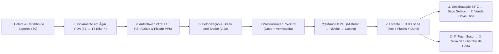
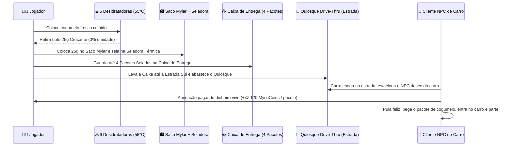

# 🍄 MycoCampus3D — Universidade Virtual 3D do Cultivo de Cogumelos

<p align="center">
  
  
  
  
</p>

O **MycoCampus3D** é uma universidade virtual e simulador 3D multiplayer em tempo real executado **100% no navegador** (PC, tablets, Android e iPhone/iOS em Tela Cheia). O projeto ensina e simula **micologia aplicada e o ciclo completo da vida real de um micologista** — desde a coleta de esporos na floresta, isolamento genético (`T0 → T3 Elite`) no Fluxo Laminar, microscopia óptica em `1000x`, esterilização a `121°C / 15 PSI`, pasteurização de substratos bulk (`75–85°C`), montagem e nivelamento de **Monotubs 24L**, frutificação sob estante com **Luz LED Direcional** e na **Estufa Climatizada Automática** até **4 Flushs**, compostagem dos bolos esgotados na **Horta Orgânica Externa**, desidratação crocante (`0% UR`), embalagem selada em sacos Mylar e venda em **Caixas de Entrega no Drive-Thru da Estrada para NPCs que param de carro e pagam em 🪙 MycoCoins**!

---

## 🧭 Sumário Rápido

1. [🔬 Ciclo Completo do Cultivo Micológico (Passo a Passo Realista)](#-1-ciclo-completo-do-cultivo-micológico-passo-a-passo-realista)
2. [♨️ Sala de Desidratação, Embalagem Selada & Drive-Thru de Vendas (🪙 MycoCoins)](#️-2-sala-de-desidratação-embalagem-selada--drive-thru-de-vendas--mycocoins)
3. [🌱 Horta Orgânica Externa & Compostagem Micelial](#-3-horta-orgânica-externa--compostagem-micelial)
4. [🥚 Easter Eggs Secretos & Experiências Especiais do Campus](#-4-easter-eggs-secretos--experiências-especiais-do-campus)
5. [🏛️ Mapa & Setores do Campus 3D](#️-5-mapa--setores-do-campus-3d)
6. [🏗️ Arquitetura Técnica, Otimização 3D & Stack](#️-6-arquitetura-técnica-otimização-3d--stack)
7. [📁 Estrutura Modular do Repositório](#-7-estrutura-modular-do-repositório)
8. [🗄️ Esquema do Banco de Dados (MySQL) & Endpoints da API](#️-8-esquema-do-banco-de-dados-mysql--endpoints-da-api)
9. [👥 Cargos (RBAC), Painel Master Admin & Modo Editor 3D](#-9-cargos-rbac-painel-master-admin--modo-editor-3d)

---

## 🔬 1. Ciclo Completo do Cultivo Micológico (Passo a Passo Realista)

Cada ferramenta e recipiente do laboratório segue rigorosamente a microbiologia e o dia a dia real de um laboratório de micologia:



### 🧫 1.1. Coleta de Esporos, Germinação e Isolamento Genético (`T0 → T1 → T2 → T3 Elite ⭐`)
- **Carimbo de Esporos (*Spore Print*):** Colha um cogumelo fresco (na natureza, no pasto, na Estufa ou no Monotub 24L), abra uma **Placa de Petri Vazia** e clique com o cogumelo para assistir à **animação 3D do chapéu soltando a nuvem roxa de esporos** e depositando o carimbo radial das lamelas.
  - *Regra de Assepsia Real:* Nunca deixe uma placa com Carimbo de Esporos aberta fora do Fluxo Laminar, ou esporos de mofo do ar cairão sobre a amostra!
- **Raspagem com Bisturi #24 (`scrape_spores`):** Com o **Bisturi Cirúrgico Inox** equipado com lâmina estéril `#24` dentro do **Fluxo Laminar ligado e higienizado**, raspe um ponto microscópico de esporos do carimbo e inocule em uma **Placa de Petri Estéril (PDA/BDA)** ou em um **Potinho PP5 145ml de Flocão de Milho**.
- **Evolução de Linhagem (`T0 → T1 → T2 → T3 Elite ⭐`):**
  - **`[T0 Esporos]`:** Germinação multiesporos inicial.
  - **`[T1 Setorizada]`:** 1ª transferência de micélio selecionado com o bisturi.
  - **`[T2 Rizomórfica]`:** 2ª transferência com cordões miceliais vigorosos.
  - **`[T3 Elite ⭐]`:** 3ª transferência clonal pura — **acelera a velocidade de colonização e frutificação em todas as etapas seguintes**!
- **Vedação com Parafilm M & Conservação a `4°C`:** Vede as placas fechadas com **Parafilm M** e guarde na **Geladeira de Culturas (`4°C`)**, ampliando a validade de **15 dias** (temperatura ambiente `25°C`) para **90 dias** (refrigerada).

### 🔥 1.2. Lamparina a Álcool 3D com Chama Viva & Assepsia em 3 Etapas
- **Flambagem de Lâminas e Agulhas (`makeAlcoholLamp`):** Duas **Lamparinas a Álcool de Vidro com Chama Viva** ficam dentro da Capela de Fluxo Laminar. Ao apontar com um **Bisturi #24** ou **Seringa 10ml** usados/contaminados para a chama, o metal brilha **laranja-incandescente** e é **re-esterilizado 100% na hora**!
- **Luvas Nitrílicas Pretas + Álcool 70% nas Mãos:** Calce as luvas da caixa (`160s` de proteção). Se o tempo estiver acabando, basta **borrifar Álcool 70% no ar (sem alvo)** enquanto usa luvas para higienizar as próprias mãos enluvadas e renovar os `160s`!
- **Higienização de Superfícies e Caixas (`3x Álcool 70% + Papel Toalha`):** Borrife Álcool 70% até umedecer e passe o **Rolo de Papel Toalha Asséptico** para secar e ativar `120s` de proteção antimicrobiana.

### 🔬 1.3. Microscópio Óptico Binocular 3D (`1000x`)
- Dois **Microscópios Ópticos Binoculares (`1000x`)** estão posicionados na bancada do laboratório.
- Clique no microscópio segurando qualquer **Placa de Petri**, **Frasco de Cultura Líquida**, **Potinho PP5**, **Vidro/Bag de Grãos** ou **Cogumelo** para abrir a **Lente Óptica Circular `1000x` ao vivo**:
  - **Carimbo de Esporos:** Exibe centenas de basidiósporos elipsoidais roxo-escuros.
  - **Micélio Saudável (`T0–T3`):** Exibe a rede de hifas ramificadas com **grampos de conexão (*clamp connections*)** confirmando micélio dicariótico saudável.
  - **Diagnóstico Precoce de Contaminação:** Detecta endósporos bacterianos de *Bacillus* ou conídios verdes de *Trichoderma harzianum* **antes mesmo da contaminação ficar visível a olho nu**!

### 🍲 1.4. Esterilização (`121°C / 15 PSI`) vs. Pasteurização (`75–85°C`) & *"Break and Shake"*
- **Diferença Realista na Panela de Pressão / Autoclave (Tecla `M`):**
  - **Modo ESTERILIZAR (`121°C / 15 PSI`):** Obrigatório para **Grãos (Milho, Trigo, Sorgo, Flocão PP5)** e **Meio Líquido/Ágar PDA**, eliminando endósporos termorresistentes. Se você apenas pasteurizar grãos a 75°C, o jogo alerta: `(Apenas Pasteurizado 75°C ⚠️ Grãos exigem Esterilizar a 121°C / 15 PSI!)`.
  - **Modo PASTEURIZAR (`75–85°C`):** Ideal para **Substrato Bulk (Vermiculita + Pó de Coco + Água)**, eliminando pragas e competidores enquanto preserva microrganismos benéficos que protegem o bolo contra *Trichoderma*.
- **💥 *"Break and Shake"* (Chacoalhar Grãos entre `20%` e `95%`):**
  - Quando um **Vidro 800ml** ou **Bag 1,5kg de Spawn** atingir entre `20%` e `95%` de colonização, clique nele (na bancada ou na mão) para executar o **Break & Shake**! O recipiente realiza uma animação 3D de agitação vigorosa, espalha os pontos de inoculação e **dobra a velocidade de colonização (`2.2x`)**!

### 📦 1.5. Caixa Monotub 24L Transparente + Estante Exclusiva com Luz LED Direcional
Inspirada fielmente nas caixas organizadoras reais de 24 Litros com **liner preto inferior**, **presilhas pretas articuladas nas alças**, **8 furos de troca gasosa (FAE) com lã acrílica (*polyfill*)** e **tampa transparente articulada**:
1. **Abrir a Tampa & Higienizar:** Clique para destravar as presilhas e abrir a tampa. Borrife **Álcool 70%** e seque com **Papel Toalha** (montar a caixa sem higienizar gera alto risco de **Trichoderma / mofo verde** aos 45% de colonização!).
2. **Despejar Spawn Colonizado + Substrato Pasteurizado:** Adicione o grão 100% colonizado e o substrato de **Vermiculita + Pó de Coco** pasteurizado.
3. **Misturar (`mixAnimTimer`):** Clique na caixa para assistir à animação 3D dos grãos girando e se misturando homogeneamente ao substrato.
4. **Nivelar com Espátula Inox (`levelAnimTimer`):** **Regra real:** *só é permitido nivelar o bolo depois de misturar!* Ao clicar para nivelar, uma **espátula/prensa inox 3D** percorre o interior da caixa compactando e alisando os montinhos até o bolo ficar perfeitamente plano.
5. **Fechar a Tampa & Colonizar até 100%:** Feche a tampa (deixar aberta fora do fluxo laminar antes de 100% contamina com *Trichoderma*!). Acompanhe as **gotículas 3D de condensação** nas paredes internas quando a umidade está `>= 85% UR`.
6. **🥥 Camada de Casing (`+40%` velocidade):** Com o bolo 100% colonizado, aplique **Vermiculita / Pó de Coco** por cima para criar a camada protetora de *Casing*.
7. **💡 Estante Exclusiva com Luz LED Direcional:** Leve o Monotub 24L para a **Estante de 3 Andares exclusiva para Monotubes** (com barras de LED azul-frio instaladas **embaixo de cada prateleira** iluminando diretamente o topo das caixas para orientar o fototropismo dos pins!).
8. **🍄 Até 4 Flushs + *"Cold Shock / Dunk"* (`99% UR`):** Colha o dossel denso de cogumelos maduros! Entre cada flush (`1/4` → `2/4` → `3/4` → `4/4`), borrife água ou leve o Monotub até a **Pia Inox / Galão 5L** para fazer o **Dunk (submersão/reidratação profunda a `99% UR`)**.
9. **🍂 Bolo Seco Esgotado após o 4º Flush:** Após colher o **4º Flush**, o bolo encolhe e assume textura seca e rachada (`Bolo Seco Esgotado`), pronto para virar adubo na **Horta Externa**!

---

## ♨️ 2. Sala de Desidratação, Embalagem Selada & Drive-Thru de Vendas (`🪙 MycoCoins`)

A **Ala Leste-Norte (`♨️ DESIDRATAÇÃO`)** foi projetada para múltiplos jogadores trabalharem juntos no pós-colheita e comercialização:



- **6 Desidratadoras Elétricas (`55°C`):** Secam cogumelos frescos até `0% de umidade (ponto crocante / cracker-dry)`. Ao retirar, você recebe o **Lote de 25g de Cogumelos Desidratados Crocantes** na mão.
- **Potes Herméticos de Vidro com Sachê de Sílica Gel (`150g`):** Guarde lotes crocantes nos potes com sachê 3D de sílica gel laranja/branca para conservação eterna no laboratório, ou leve para a linha de embalagem.
- **16 Sacos Mylar/Zip + 3 Seladoras Térmicas:** Coloque o lote de `25g` dentro de um **Saco Mylar com visor transparente**, leve até uma das **3 Seladoras Térmicas** da bancada central e sele a quente (`📦 Pacote Selado de Cogumelos 25g`).
- **6 Caixas de Entrega Comercial (`makeDeliveryCrate`):** Cada caixa comporta até **4 pacotes selados** (valor total da caixa cheia: **`🪙 480 MycoCoins`**).
- **🚗 Quiosque Drive-Thru na Estrada Sul (`x: 11.5, z: 36.2`) & Clientes NPCs de Carro:**
  - Leve sua Caixa de Entrega (ou pacotes selados avulsos) até a beira da Avenida Sul e abasteça o **Quiosque Drive-Thru MycoCampus**.
  - **Geração Inteligente de NPCs:** Os carros **só param quando há cogumelos disponíveis no quiosque**, chegando em intervalos variados com **5 perfis diferentes de compradores** (*Dr. Henrique Neurocientista*, *Chef Sofia*, *Prof. Otávio Botânico*, *Marina Terapeuta* e *Lucas Colecionador*).
  - **Animação Completa:** O carro encosta na baia, o NPC **desce do veículo, caminha até o balcão, faz a animação pagando com notas verdes e moedas douradas flutuando (`+🪙 120 MycoCoins` por pacote + XP), comemora pulando feliz, pega o pacote verde na mão, volta caminhando para o carro, entra e segue viagem pela avenida**!
- **👑 Moeda Virtual `🪙 MycoCoins` na Loja:** Use seus MycoCoins ganhos nas vendas para comprar chapéus lendários, o **Snowboard Pro MycoRide** e o **Paraglider MycoWing** diretamente no botão **👑 Loja** do HUD!

---

## 🌱 3. Horta Orgânica Externa & Compostagem Micelial

Localizada ao sul da Estufa (`x: 15..23, z: 16..20`), fechando o ciclo ecológico sustentável do campus:
- **Caixa de Substrato & Compostagem da Horta:** Traga os **Bolos Secos Esgotados** (após os 4 flushs da Estufa ou do Monotub 24L) ou substratos descartados e despeje na Caixa de Substrato.
- **Animação de Húmus & Fertilidade (`soilRichness`):** O nível de terra preta sobe suavemente, uma explosão de partículas verdes celebra a compostagem, o Monotub 24L fica limpo para um novo ciclo e a fertilidade do solo dispara até `100%`, acelerando todas as plantas!
- **Canteiro de 8 Alfaces Crespas Orgânicas & 6 Tomateiros com Estacas:** As folhas balançam suavemente ao vento enquanto **3 borboletas 3D coloridas** voam em `"8"` batendo asas sobre os canteiros.
- **🧺 Cesta de Colheita Orgânica da Horta:** Cada alface ou tomate vermelho colhido concede **XP e pontos de colheita** e preenche visualmente a cesta de madeira da horta!

---

## 🥚 4. Easter Eggs Secretos & Experiências Especiais do Campus :")

O **MycoCampus3D** esconde dezenas de segredos, eventos psicodélicos e interações divertidas pelo mundo 3D:

| Easter Egg / Segredo | Onde Encontrar & Como Ativar | O que Acontece! |
| :--- | :--- | :--- |
| 🐄💩 **Vaquinhas do Pasto & *Psilocybe cubensis* no Esterco** | Pasto Leste (`x: 35..75, z: 8..50`) | Faça carinho nas vaquinhas (**Mimosa, Estrela, Malhada, Florzinha, Branquinha e Pintada**) para ver corações e ouvir o mugido! Periodicamente elas deixam **esterco orgânico fresco** no pasto; quando chove ou a umidade sobe, brotam **Cogumelos Mágicos Dourados (*Psilocybe cubensis*)** direto do esterco (`+40 XP`)! |
| 🌈🍄 **Viagem Psicodélica em 3 Níveis + Gnomos Dourados & Levitação** | Comer *Psilocybe cubensis* colhido (segure na mão e clique) | **1º e 2º Cogumelo:** ativa o *Golden Teacher Trip* com filtro caleidoscópico suave, mandalas sagradas, partículas brilhantes e **Gnomos Mágicos 3D** dançando ao seu redor! **3º Cogumelo (*Overdose / Bad Trip*):** o mundo entra em distorção intensa (*freakout*), você desmaia por 2,4s e **acorda levitando a 36 metros de altura no céu com um Paraquedas Redondo de Emergência** descendo suavemente de volta ao campus! |
| 🛸👽 **Abdução Alienígena por OVNI (UFO Disco Voador)** | Céu do Campus / Pasto & Floresta (`world/ufo-abduction.js`) | Um **Disco Voador (OVNI) iluminado com feixe trator abduzidor** patrulha o céu do campus, emitindo luzes neon e sons espaciais! |
| 🏂🏔️ **Snowboard Pro MycoRide com Carving nas Montanhas** | Desbloqueie na **👑 Loja → 🏂 Brinquedos** (ou atalho `B`) e teleporte para **🏔️ Montanhas** no **🗺️ Mapa** | Suba a cordilheira a `28,5m` de altitude e desça deslizando em alta velocidade com física real de inclinação (*carving*), prancha 3D visível nos seus pés ao olhar para baixo e manobras aéreas! |
| 🪂🌬️ **Paraglider MycoWing & Correntes Térmicas Ascendentes** | Desbloqueie na **👑 Loja → 🏂 Brinquedos** (ou atalho `P`) | Salte do pico das montanhas de parapente e entre nos **anéis de correntes térmicas de ar quente** espalhados pelo vale para ganhar altitude e sobrevoar a Praça Central, o Lago em 8 e a Torre do Relógio! |
| 🌈⛅ **Arco-Íris Espectral de 92m pós-Chuva** | Cordilheira Norte (automático após chuva) | Sempre que uma tempestade de chuva cessa e o sol volta a abrir no ciclo climático, um **Arco-Íris 3D de 92 metros com as 7 cores do espectro óptico** surge sobre as montanhas! |
| ⚽🏀 **Futebol com Comemoração de Gol & Basquete com Cesta Real** | Complexo Esportivo Oeste (`x: -50, z: -15`) | Chute a bola de futebol no campo (física 3D Zero-GC); ao marcar gol nas traves, **explode uma chuva de confetes coloridos** com som de torcida! Na quadra ao lado, pegue a **Bola de Basquete** na mão, mire no aro laranja e arremesse para fazer cesta! |
| 🔫🌡️ **Termômetro Laser Infravermelho nos Amigos e nas Vacas** | Bancada do Lab (`infrared_thermometer`) | Ligue a mira laser vermelha e aponte para **outros jogadores online** ou para as **vaquinhas** para medir a temperatura corporal metabólica real (`36,8°C`), ou aponte para o fogareiro (`240°C`), autoclave (`121°C`) e geladeira (`4,0°C`)! |
| 🕰️🔔 **Torre do Relógio Sincronizada com o Horário Virtual** | Praça Central / Topo da Escadaria (`world/staircase-clock.js`) | Os ponteiros do relógio monumental da torre giram em tempo real sincronizados com a posição do Sol, da Lua e das estrelas do campus! |
| 🎬📽️ **Cinema & Auditório Interativo com Projetor de Luz** | Leste do Campus (`x: 48, z: -6.5`) | Sente-se nas poltronas do auditório e clique diretamente nos botões do **Telão de Cinema 3D** para ligar o feixe volumétrico do projetor, escolher entre os **5 Módulos Visuais Animados de Micologia** e pausar/avançar aulas! |

---

## 🏛️ 5. Mapa & Setores do Campus 3D

Você pode caminhar livremente ou usar o botão **🗺️ Mapa** no topo da tela para se teletransportar instantaneamente para qualquer um dos **10 setores**:

1. **🏛️ Praça Central:** Chafariz monumental do Cogumelo Amanita com jatos d'água animados, bancos de madeira interagíveis, canteiros floridos e escadaria da Torre do Relógio.
2. **🧪 Laboratório Asséptico (Ala Oeste-Norte):** Capela de Fluxo Laminar com filtro HEPA, 2 Lamparinas a Álcool com chama viva, 2 Microscópios Ópticos Binoculares 1000x, Autoclave/Panela de Pressão com Fogareiro Digital, Agitador Magnético, Geladeira 4°C, Pia Inox com Torneira, Seladora Térmica, Balança de Precisão com TARA, Potes Herméticos com Sílica Gel, Bisturis #24, Seringas 10ml, Tubos Falcon e Lousa Interativa.
3. **📦 Depósito de Insumos (Ala Oeste-Sul):** 3 Estantes Porta-Pallet abastecidas com dezenas de Bags 1,5kg, Vidros 800ml, Sacos de 5kg (Milho, Trigo, Sorgo, Serragem), 40 Placas de Petri, Caixas de Luvas Pretas, Papel Alumínio, Fita Micropore, Parafilm M e Seringas extras para grupos grandes de jogadores.
4. **♨️ Sala de Desidratação, Embalagem & Monotubs LED (Ala Leste-Norte):**
   - Bancada com **6 Desidratadoras 55°C**;
   - Bancada Central com **16 Sacos Mylar/Zip**, **3 Seladoras Térmicas**, **Balança de Precisão** e **6 Caixas de Entrega Comercial**;
   - Estação de Pasteurização com Tripé a Gás, Panela e **8 Sacos de 5kg de Vermiculita e Pó de Coco**;
   - **Estante Exclusiva com Luz LED Direcional** e **8 Caixas Monotub 24L Transparentes**.
5. **🍄 Estufa Climatizada Automática (Ala Leste-Sul):** 24 slots de frutificação em 2 estantes inox de 3 andares, Painel Controlador PID (Auto/Manual), Umidificador Ultrassônico com névoa 3D, Exaustor de CO₂, Climatizador de 3 Ventoinhas e **Sensor de Porta Aberta com Alarme Sonoro**.
6. **🌱 Horta Orgânica Externa:** Caixa de Substrato & Compostagem Micelial, Canteiro de 8 Alfaces Crespas, Canteiro de 6 Tomateiros, Cesta de Colheita e 3 Borboletas 3D.
7. **🚗 Drive-Thru de Vendas na Estrada Sul:** Quiosque comercial na beira da avenida onde carros de NPCs estacionam para comprar suas caixas de cogumelos desidratados por **🪙 MycoCoins**.
8. **🎬 Cinema & Auditório:** Anfiteatro com poltronas e telão interativo de videoaulas animadas em Canvas 2D/3D.
9. **⚽ Complexo Esportivo & Quadras:** Campo de futebol com arquibancada, quadra de basquete com tabelas e aros funcionais e 2 quadras de tênis.
10. **🌲 Bosque, Lago Duplo em 8 & 🏔️ Montanhas:** Ponte de madeira arqueada sobre o lago cristalino, 32+ pontos de cogumelos silvestres catalogáveis na **🍄 Micoteca** e pista alpina de Snowboard/Paraglider.

---

## 🏗️ 6. Arquitetura Técnica, Otimização 3D & Stack

- **Motor 3D (Front-end):** [Three.js r187](https://threejs.org/) com `three-mesh-bvh` e `mergeGeometries` empacotados em [js/vendor/three.bundle.min.js](file:///d:/Users/ghost/Documents/Game%20Cultivo%20de%20Cogu/js/vendor/three.bundle.min.js) (100% *self-hosted*, zero frameworks pesados, zero CDN externo).
- **Otimizador de Cena, BVH & Auto-FPS ([js/engine/scene-optimizer.js](file:///d:/Users/ghost/Documents/Game%20Cultivo%20de%20Cogu/js/engine/scene-optimizer.js), [js/core/quality.js](file:///d:/Users/ghost/Documents/Game%20Cultivo%20de%20Cogu/js/core/quality.js)):**
  - `freezeStaticWorld()` mescla geometrias estáticas opacas em células espaciais de `32x32m` com árvore BVH e virtualiza `PointLight`s em um pool fixo de 4 luzes ativas no shader.
  - **Qualidade Adaptativa + DRS (*Dynamic Resolution Scaling*):** Ajuste automático entre `Auto`, `Alto`, `Médio`, `Baixo` e `Mínimo` (botão **⚡ Qualidade** sempre visível no HUD desktop e mobile).
- **Compatibilidade Total Mobile & iPhone (iOS Safari / WebApp Tela Cheia):**
  - Suporte nativo a **Tela de Início (Standalone Fullscreen)** no iPhone sem faixa preta inferior em landscape (`100lvh`, `--app-vw`, `--app-vh` via `visualViewport`), Assistente iOS (`#ios-fullscreen-modal`), bloqueio de auto-zoom em inputs (`16px`), colisão OBB precisa em mesas rotacionadas e HUD mobile compacto que nunca transborda a tela.
- **Back-end & Multiplayer em Tempo Real:** PHP 8.x nativo com PDO MySQL ([api/db.php](file:///d:/Users/ghost/Documents/Game%20Cultivo%20de%20Cogu/api/db.php), [api/auth.php](file:///d:/Users/ghost/Documents/Game%20Cultivo%20de%20Cogu/api/auth.php), [api/multiplayer.php](file:///d:/Users/ghost/Documents/Game%20Cultivo%20de%20Cogu/api/multiplayer.php), [api/multiplayer_schema.php](file:///d:/Users/ghost/Documents/Game%20Cultivo%20de%20Cogu/api/multiplayer_schema.php)) com migrações automáticas cacheadas (`MC_SCHEMA_VERSION = 10`).

---

## 📁 7. Estrutura Modular do Repositório

```text
├── index.html                        # Entrada principal, Lobby, Canvas WebGL, HUD Compacto & Modais (?v=1.4.0)
├── VERSION                           # Versão semântica atual (1.4.0)
├── CHANGELOG.md                      # Histórico completo de versões
├── README.md                         # Documentação completa do projeto, mecânicas e easter eggs
│
├── api/                              # Back-end RESTful em PHP 8 + PDO MySQL
│   ├── db.php                        # Conexão PDO, migrações cacheadas (MC_SCHEMA_VERSION = 10) e tokens
│   ├── auth.php                      # Login/registro, XP, colheitas, missão prática, cosméticos, ranking e Admin
│   ├── multiplayer.php               # Sync em tempo real (avatares, objetos em lote, estados, lousas, chat)
│   └── multiplayer_schema.php        # Whitelist de todos os itens do campus e sanitização de estado JSON
│
├── js/                               # Arquitetura ES Modules nativa
│   ├── main.js                       # Ponto de entrada único
│   ├── core/                         # Config, logger, constantes, lições, eventos, estado e Auto-FPS/DRS (quality.js)
│   ├── services/                     # AudioEngine Web Audio (audio-engine.js), api-client, multiplayer-sync
│   ├── engine/                       # SceneOptimizer (BVH/merge), textures, physics (OBB), cinema, environment, rainbow
│   ├── world/                        # Praça, prédios, relógio, estufa, mata, horta (campus-garden.js), salas (lab-tools.js)
│   ├── items/                        # Módulos dedicados por equipamento:
│   │   ├── petri-dish.js             # Placas de Petri, Carimbo de Esporos 3D, Ágar PDA e gerações T0..T3 Elite
│   │   ├── spawn-containers.js       # Vidros 800ml, Bags 1,5kg e mecânica Break & Shake (2.2x)
│   │   ├── monotub.js                # Caixa Monotub 24L Transparente, Casing, Dunk, Condensação e Estante LED
│   │   ├── lab-advanced-tools.js     # Lamparina a Álcool 3D, Microscópio Óptico 1000x e Potes c/ Sílica Gel
│   │   ├── dehydration-packaging.js  # Sacos Mylar, Caixas de Entrega, Quiosque Drive-Thru, Carros/NPCs e MycoCoins
│   │   └── ...                       # Autoclave, fluxo laminar, seringa, bisturi, desidratadora, balança, geladeira
│   ├── entities/                     # Avatares MP, braço 1ª pessoa, termômetro laser, badge 3D (hover-3d-badge.js), vacas
│   ├── systems/                      # Init, game loop, movimento, input, interações, raycasters e ações de cultura
│   └── ui/                           # Boot UI, HUD/lobby, mapa/missão, loja com MycoCoins, controles mobile e modais
│
└── tests/                            # Suíte automatizada (npm run check & npm test)
    ├── static-integrity.test.mjs     # Garante 100% dos imports/exports ES válidos e zero arquivos órfãos
    ├── greenhouse.test.mjs           # Testa Estufa, Monotub 24L, Horta, Microscópio 1000x, Lamparina e Drive-Thru
    └── ...                           # Testes de qualidade/GPU, ciclo de cultura, assepsia, raycasting e versão
```

---

## 🗄️ 8. Esquema do Banco de Dados (MySQL) & Endpoints da API

| Tabela | Finalidade |
| :--- | :--- |
| `mc_meta` | Armazena configurações globais e o `schema_version` atual (`10`). |
| `mc_users` | Cadastro persistente: nome, hash da senha, cargo, cores do avatar, XP, cogumelos colhidos, módulos e cosméticos. |
| `mc_auth_tokens` | Tokens de sessão SHA-256 com validade de 30 dias. |
| `mc_sessions` | Estado em tempo real dos jogadores online (posição $X,Y,Z$, rotação, item segurado, emote, chat em balão). |
| `mc_user_poses` | Última posição e rotação salvas do jogador para retorno contínuo. |
| `mc_world_objects` | Coordenadas sincronizadas em tempo real de todos os itens e bancadas móveis. |
| `mc_world_item_states` | Estados internos compartilhados (volumes, esterilização, colonização, desidratadora, etc.). |
| `mc_world_state` | Estados globais (portas, persianas, interruptores, fluxo laminar, estufa e telão do auditório). |
| `mc_board_strokes` | Traços vetoriais compartilhados das 4 lousas interativas. |
| `mc_world_layout_edits` / `mc_admin_layout_defaults` | Persistência do Modo Editor 3D do Master Admin. |

---

## 👥 9. Cargos (RBAC), Painel Master Admin & Modo Editor 3D

1. **🎓 Aluno (`student`):** Explora todo o campus, cultiva do esporo ao Monotub 24L, desidrata, embala e vende cogumelos no Drive-Thru por **🪙 MycoCoins**, conclui os 5 módulos teóricos (`+50 XP` cada) e a Missão Prática (`+100 XP`).
2. **👨‍🏫 Professor (`professor`):** Controla os slides do Telão do Auditório para toda a turma e pode resetar os itens do laboratório.
3. **👑 Master Admin (`admin`):** Acesso ao **Painel Master Admin (`🛡️ Admin`)** com busca de jogadores online, teletransporte (`🧲 Puxar` / `🚀 Ir até`), gestão de cargos e **🛠️ Modo Edição 3D ao vivo** (arrastar bancadas inox com todos os equipamentos em cima, girar grupos `+90°`, adicionar novos prefabs e salvar o layout padrão no MySQL).

---

## 📘 Trilhas solo

Abra **Missão → Aprender Sozinho** para escolher uma das quatro trilhas. As etapas são marcadas manualmente e ficam salvas no navegador. O cartão de inspeção ajuda a interpretar o estado do item durante a partida.

## 🧪 Como Executar os Testes Localmente

```bash
# Sincronizar versão entre VERSION, package.json, index.html e sw.js
npm run sync-version

# Verificar sintaxe de todos os módulos JS
npm run check

# Executar toda a suíte de testes automatizados (Node Test Runner)
npm test
```
